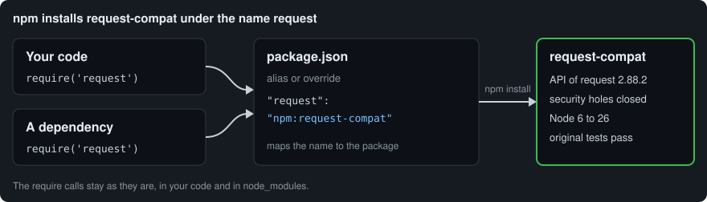

# request-compat

[](https://github.com/HenkerX64/request-compat/actions/workflows/test.yml)

`request` was deprecated in 2020 and gets no more fixes, yet a lot of code
still needs it, often inside a dependency you cannot change. request-compat
is a drop-in replacement for `request` 2.88.2: npm installs it under the
name `request`, so your code and your dependencies keep calling
`require('request')` and get the same API and behaviour, with the security
holes of request's own code closed.



It buys you time and covers the code you cannot rewrite. Where you can
rewrite, Node's `fetch` or another maintained HTTP client is still the
long-term way out.

## What you get

- **Nothing to rewrite.** Callbacks, streams, `request.defaults`,
  `request.jar`, `request-promise` and `request-promise-native` work
  unchanged. The 55 test files of request 2.88.2 still run and pass; 8 of
  them needed fixes for newer Node, Docker or the security fixes below,
  each explained in its commit, and 2 got new cases.
- **Security holes closed**, among them CVE-2023-28155, CVE-2025-7783,
  CVE-2026-12143 and Node's CVE-2026-58040:
  - your cookies, your `Authorization` header and your passwords stay
    behind on a redirect to another host;
  - a broken redirect no longer ends the process;
  - certificate pinning with `checkServerIdentity` runs behind a proxy and
    on reused connections, and `pool: false` no longer bypasses your proxy;
  - form uploads get random boundaries and escaped field names.
- **Old Node too.** It runs on Node 6 and later, as request's own `engines`
  field promised; CI runs the tests on every even (LTS) Node major from 6
  to 26.
- **Nothing new to learn.** No new features and no new options, except one
  opt-in switch back to old behaviour (`allowInsecureRedirect`).

npm audit no longer reports qs and tough-cookie. Their fixed versions
change how query strings and cookies are parsed, which request relies on,
so request-compat keeps qs 6.5.5 and tough-cookie 2.5.0 as copies in
`lib/vendor/` and backports only their security fixes: GHSA-6rw7-vpxm-498p
and GHSA-4mjr-xmp4-gh2g in qs, GHSA-72xf-g2v4-qvf3 in tough-cookie. npm
no longer installs qs and tough-cookie with request-compat, so code that
requires them lists them in its own `package.json`. Tests cover each fix;
what the fixes and the copies change is listed under
[Cookies and query strings](#cookies-and-query-strings).

## Use it

Your own code: `require('request')` stays as it is.

```sh
npm install request@npm:request-compat@^2.88.6
```

A dependency that needs `request` (npm 8.3 or later):

```json
{
  "overrides": {
    "request": "npm:request-compat@^2.88.6"
  }
}
```

Then check that every copy is replaced: `npm ls request` shows
`request@npm:request-compat@2.88.6` for each of them.

Your code and a dependency at once, npm before 8.3, yarn 1 and pnpm (not
tested yet), how to check the result and how to go back:
[docs/migration.md](docs/migration.md).

## Differences from request 2.88.2

Two changes can break code that works today: code that passes its own
`agent` and follows a redirect between http and https gets an error (see
the first item below), and on Node 16 and later code that waits for a
callback after `abort()` waits in vain, as on Node 14 and earlier. The
other changes close leaks and crashes. Bug fixes taken from a fork of
request or from Node, among them the body resend on 307 and 308
redirects, change behaviour too; they are listed in
[CHANGELOG.md](CHANGELOG.md).

### Redirects

- **Your own agent across http and https (CVE-2023-28155).** A redirect from
  HTTP to HTTPS or back keeps an `agent` or `agentClass` passed by the caller
  and fails with `Protocol "https:" not supported` (code
  `ERR_INVALID_PROTOCOL` from Node 10). 2.88.2 replaced your agent silently.
  `allowInsecureRedirect: true` restores the old behaviour and with it the
  hole. Agents created by request, among them its proxy tunnel agent, are
  replaced as before, so a request through a proxy still follows such a
  redirect.
- **Cookies stay behind on a redirect to another host.** A redirect to
  another host no longer sends the previous host's cookies: the `Cookie`
  header passed by the caller is dropped, and the jar adds only the cookies
  of the new host. Back on the first host with the same scheme and port the
  caller's header is sent again, as with curl; no other host, scheme or port
  gets it after that. A `Secure` cookie of the jar no longer goes out over
  http after a redirect from https on the same host.
- **`Authorization` stays behind on a 307 to another host.** A 307 redirect
  to another host drops the `Authorization` header, as every other redirect
  status already did. An `aws` signature and its session token are no
  longer sent to another host; back on the first host with the same scheme
  and port the request is signed again.
- **Passwords stay behind on a redirect to another host.** After a redirect
  to another host, a 401 challenge there no longer gets the user and
  password of the first host (`auth` with `sendImmediately: false`, basic
  or digest); back on the first host with the same scheme and port it gets
  them again, as with curl. request-compat 2.88.3 and 2.88.4 also gave them
  to the first host name on another scheme or port, for example over http.
- **A broken `Location` is an error, not a crash.** A redirect whose
  `Location` cannot be parsed, for example because of malformed
  percent-encoding or an invalid host, calls back with the parse error. In
  2.88.2 the error was thrown out of the response handler and ended the
  process; Node's `fetch` rejects such a redirect too.

### Proxies and TLS

- **Certificate pinning behind a proxy.** Behind a proxy,
  `checkServerIdentity`, also from `agentOptions`, runs as on a direct
  request. In 2.88.2 it was not passed into the proxy tunnel, so
  certificate pinning was skipped without an error; curl pins the target
  behind a proxy too.
- **`pool: false` keeps the proxy.** With `pool: false`, an https request
  through a proxy still goes through the proxy. In 2.88.2 `pool: false`
  replaced the tunnel agent, so the request connected to the target
  directly; curl uses the configured proxy in any case.
- **Certificate pinning on shared connections (Node CVE-2026-58040).** If
  you pin certificates with `checkServerIdentity`, top-level or in
  `agentOptions`, there is nothing to change: the check now runs where
  2.88.2 skipped it.
  - A request with its own check no longer takes a keep-alive socket or
    resumes a TLS session that another request opened without that check,
    and a pooled agent with another check no longer replaces it.
  - A request without a check no longer gets the check of another
    request's pooled agent instead of Node's default.
  - Requests whose `agentOptions` carry the same check function share their
    pooled agent, as with an agent-level check in Node.
  - With an agent from request's pool or Node's global agent, such a
    request gets a connection of its own and its check runs. With an agent
    passed by the caller or a global agent a library replaced, it only
    opens a new TLS session, and a keep-alive socket of such an agent is
    still reused on older Node (RC-13 in [docs/tracker.md](docs/tracker.md)).
  - An agent with a check of its own, passed by the caller or set on Node's
    global agent, keeps its check and its sessions, as in Node.
  - A request with its own connection shares neither keep-alive sockets nor
    the `pool.maxSockets` limit, as on Node 22.23.2 and later.
  - Node before 22.23.2, 24.18.1 and 26.5.1 skipped the check on a reused
    socket or session (CVE-2026-58040).

### Forms and uploads

- **Random boundaries, escaped field names.** `formData` uses form-data
  2.5.6: the multipart boundary is 24 random hex characters from `crypto`
  instead of 24 `Math.random` digits (CVE-2025-7783), and `"`, CR and LF in
  field names and filenames are sent as `%22`, `%0D` and `%0A`
  (CVE-2026-12143).
- **Authenticated uploads on keep-alive.** With `auth.sendImmediately:
  false`, the first, unauthenticated request of a `formData` upload no
  longer announces the form's `content-length`. The authenticated retry
  then works on keep-alive sockets (the default since Node 19) instead of
  failing with 400.

### Cookies and query strings

- **Cookies named like prototype members (CVE-2023-26136).** The cookie
  jar keeps its cookies in objects without a prototype, as tough-cookie
  4.1.3 does. A cookie for the host `__proto__` or `constructor` no longer
  writes to `Object.prototype` or `Object`, and a cookie named `__proto__`,
  `toString` or after another `Object.prototype` member is stored, sent
  and expired like any other. In 2.88.2 a `Set-Cookie: __proto__=x` made
  the next request to that host fail with a TypeError, and ended the
  process when a redirect followed. On Node 10 and later `util.inspect` of
  the jar's store shows `[Object: null prototype]`.
- **More `a[]` values than `arrayLimit` (CVE-2025-15284).** With `qs`,
  the query string of `url` is parsed again. A `[]` key with more values
  than `arrayLimit` (20 by default, see `qsParseOptions`) becomes an
  object with the indices as keys instead of an array, as in qs 6.14.1.
  With the default `qsStringifyOptions` the URL stays the same; with
  `arrayFormat: 'brackets'` or `'repeat'` or `indices: false`, such
  values go out as `a[0]`, `a[1]` and so on, with `allowDots` as `a.0`,
  `a.1` and so on. An index under `[]` that reaches the limit keeps its
  number: `a[][20]=x` goes out as `a[20]=x` instead of `a[0]=x`. OAuth
  signs such values as `a[0]`, `a[1]` and so on instead of `a`; both
  differ from the `a[]` that is sent (request-#2284 in
  [docs/tracker.md](docs/tracker.md)). Repeated keys without brackets
  (`a=1&a=2`) stay an array.
- **A non-function `constructor.isBuffer` (CVE-2026-82417).** A `qs` or
  `form` value such as `{constructor: {isBuffer: 'x'}}` is stringified like
  any other object; 2.88.2 threw a TypeError from `request()`. Parsing the
  query string of `url` with `qsParseOptions` `plainObjects` or
  `allowPrototypes` can produce such a value.
- **Cookie objects of your own tough-cookie.** When your project used
  tough-cookie 2.5 too, npm installed it once for both, so request's
  `Cookie` objects and yours were of one class. The copy in `lib/vendor/`
  has a class of its own. `jar.setCookie()` still takes a `Cookie` of your
  tough-cookie, stores a copy of it and returns the copy instead of your
  object. It takes `Cookie`
  objects of tough-cookie 3 and 4 too, which 2.88.2 rejected with a
  TypeError. The other way round, a `Cookie` from `request.cookie()` or
  `jar.getCookies()` is no instance of your tough-cookie's `Cookie`, and a
  `CookieJar` of tough-cookie 2.5 throws a TypeError for it; pass
  `cookie.toString()` instead.

### Newer Node

- **No unhandled `har` rejection.** The `har` option no longer goes through
  har-validator. In 2.88.2 the validator never stopped an invalid HAR
  object (it was applied as given anyway), but it left an unhandled promise
  rejection, which ends the process on Node 15 and later. That rejection is
  gone.
- **Aborting stays quiet.** On Node 16 and later an aborted request no
  longer raises an unhandled `error`, as on older Node. `abort()` after the
  response headers no longer calls back or emits `ECONNRESET`; request stays
  silent after `abort()`, as it did on Node 14 and earlier.

Known issues that stay as in 2.88.2 are listed in
[docs/tracker.md](docs/tracker.md#known).

## Documentation

- [docs/migration.md](docs/migration.md): switching from request, checking
  the installed package, going back
- [docs/api/](docs/api/README.md): the request API by topic: streaming, forms,
  authentication, proxies, TLS, all options, convenience methods, examples
- [CHANGELOG.md](CHANGELOG.md): every change on top of request 2.88.2
- [docs/tracker.md](docs/tracker.md): planned, known and rejected problems
- [packages/undici](packages/undici/README.md): request-compat-undici, the same core on undici (beta)
- [packages/got](packages/got/README.md): request-compat-got, the same core with got's hooks around Node's `http` (beta)
- [packages/impit](packages/impit/README.md): request-compat-impit, the same core on impit with a browser's TLS and HTTP/2 fingerprint (beta)
- [CONTRIBUTING.md](CONTRIBUTING.md) and [AGENTS.md](AGENTS.md): how
  changes are made and the rules they follow

## Credits

request was written by Mikeal Rogers and its contributors; request-compat
keeps their history and authorship. Apache License 2.0, see
[LICENSE](LICENSE).
